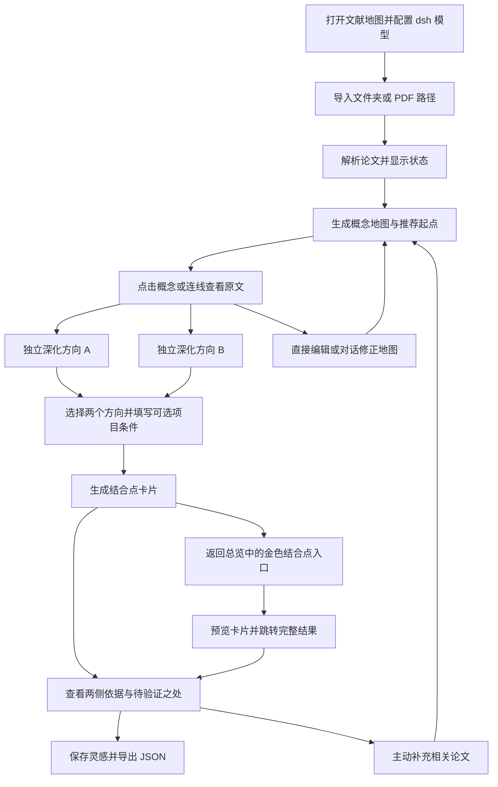

# 文献地图：当前用户使用流程

依据：0.1.0 修改版的界面与后端实现，核对日期为 2026-10-22。

## 一条完整路径

**打开插件 → 导入本地论文 → 生成关键词地图 → 查看概念与原文 → 分别建立方向 A / B → 寻找结合点 → 回地图预览或查看完整卡片 → 保存、阅读和继续迭代。**

## 1. 进入工作台

在 dsh 侧边栏点击「文献地图」。工作区分为三部分：

- 左侧「我的论文库」：查看导入的论文、页数、可用材料与解析状态。
- 中间：在「关键词地图」「探索方向」「结合点」「已保存」之间切换。
- 右侧「解释与依据」：显示当前所选对象的说明、论文与原文；底部提供对话修改入口。

第一次使用时，先在 dsh 中连接模型。插件使用该 profile 的默认模型；导入解析在本机执行，生成地图、深化方向、比较和对话修改会使用模型。

## 2. 导入本地论文

点击「导入论文」，选择文件夹或粘贴路径。也可以逐行填写多个 PDF 路径。

系统逐篇解析文字，显示当前论文和进度；左侧更新解析结果。无法读取或没有足够文字的论文会显示错误，不会被假装分析成功。原始 PDF 保持原样。

目前支持带文字层的 PDF。扫描件需先做 OCR。暂不通过飞书链接同步资料。

## 3. 生成并浏览地图

点击「生成地图」，已有地图时按钮为「更新地图」。系统先逐篇抽取概念、关系与引文，再整理同义概念、主题分组和探索起点。

用户可以：

- 从右侧「值得从这里开始」进入推荐概念。
- 在空白处拖动平移，滚轮缩放，双击空白处或点击「重置」复位。
- 点击加减按钮缩放，点击「展开全部」显示次要概念。
- 用地图搜索筛选概念名称和别名。

初始视图最多优先展示 42 个重要概念；地图搜索作用于当前展示集合。查找不在初始视图中的概念时，先展开全部。没有匹配结果不等于正文中没有相关内容。

## 4. 点击概念或关系，回到证据

点击一个概念，右侧显示同义词、相关关系和对应论文原文。点击连线，右侧显示关系说明、适用语境与证据。点击「打开原文」定位到 PDF 页序。

| 地图标记 | 含义 | 如何阅读 |
| --- | --- | --- |
| 实线 | 论文讨论或研究的关系，附有匹配到的原文 | 查看论述类型和研究语境，不能直接视为普遍因果结论 |
| 普通虚线 | AI 提出的潜在连接 | 两端概念的材料是推断起点，不直接证明这条连接 |
| 金色虚线「结合点」 | 已完成的两个方向比较的快捷入口 | 打开预览或完整卡片，查看连接机制和两侧依据 |

原文会按片段、文件版本与引用文本进行校验；无法核验的候选结果被排除，并可在论文详情中查看原因。出处校验不能代替人工评估解释是否成立。

## 5. 分别建立两个探索方向

从概念详情点击「深化这个方向」，或进入「探索方向」点击「新建方向」。填写方向名称，以及想进一步探索的问题或限定条件。

例如：

- 方向 A：跨专业沟通——不同专业如何通过设计物建立共同理解？
- 方向 B：创意管理——设计师如何外化、整理和发展创意？

两个方向都独立从**当前整个地图**选择已提取的相关概念和关系；方向 B 不受方向 A 的材料子集限制。系统保存查询条件、解释和地图快照。点击「查看地图」进入该方向的局部图，再通过「返回总览」退出。

这里的「深化」是基于现有地图筛选，不是重新对整篇 PDF 做任意语义检索，也不会自动搜索库外论文。没有匹配材料时，允许保存空结果并说明原因。

## 6. 寻找两个方向的结合点

进入「结合点」，点击「寻找结合点」，选择 A、B 两个不同方向。可以填写兴趣、已有项目、可用时间和研究方法等项目条件，但不强制填写。

系统基于两个方向已有的原文证据进行比较。每张卡片包含：

- 结合点标题与具体连接机制。
- 可以继续研究的问题。
- 推断过程与待验证之处。
- 「方向 A 的依据」「方向 B 的依据」，点击后右侧切换原文。

结果是候选研究灵感，不是已经证明的结论，也不保证选题新颖或可发表。证据不足时可以没有卡片。

## 7. 从地图回到结合点

比较完成后，返回「关键词地图」总览。系统为符合显示条件的比较生成一条金色虚线入口，标记为「结合点 1」「结合点 2」等。

点击金色线或标签，会在地图中弹出预览：两个方向名称、最多三张卡片的标题和问题、保存状态。点击「查看完整结合点」跳转「结合点」页，定位并高亮对应比较。点击空白处或预览的关闭按钮可收起预览。

一条金色入口对应**一次比较**，不对应一条已经证实的新关系。连线使用两个方向各自关联最多的代表概念作为端点；若代表概念相同，或当前地图无法定位端点，入口可能不显示，比较结果仍保留在「结合点」页。

## 8. 保存、导出与继续阅读

遇到值得保留的卡片，点击「保存灵感」，在「已保存」页回看。保存会保留问题、推断与两侧论文证据。

点击左下角「导出」，下载 JSON，包含地图、探索分支、比较卡片及编辑记录。当前不直接生成论文正文或 PowerPoint。

## 三条迭代路径

### 修正地图

在总览中点击概念，可重命名或合并同义概念；点击关系，可移除错误连线。也可在右侧输入对话要求，例如「把共创改名为协同设计」。两种方式修改同一张地图并保留历史，可撤销。调整不会把 AI 假设自动变成论文事实。

### 补充论文

点击「补充相关论文」，填写检索词后才启动 Crossref 检索。AI 筛选最多三篇、去重并加入库：

- 有摘要：标记「仅摘要」，参与后续分析。
- 只有题录：标记「仅题录」，不作为原文关系证据。

目前不自动下载出版商全文。补充成功后会自动尝试更新地图；完成后重新建立方向并比较。

### 本地文件更新

修改或增加文件后，点击「检查文件更新」，再点击「更新地图」。未变化的单篇分析尽量复用，旧图在新任务失败时保留。

地图版本或论文库变化后，旧方向和比较保留快照，并标记依据有更新；后端要求重新建立方向后再比较。已有金色入口也应连同完整比较中的更新提示一起理解。

## 当前最短试用路线

**导入十几篇 PDF → 生成地图 → 读一两个概念的原文 → 建立两个方向 → 寻找结合点 → 查看双侧依据 → 保存一张卡片 → 返回地图点击金色入口回看。**
